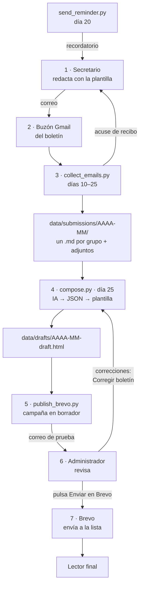

# Boletín parroquial

Sistema que prepara cada mes el boletín parroquial a partir de lo que envían por correo los secretarios de los grupos.

Los secretarios escriben un correo con lo que ha hecho su grupo y lo que viene. Un script recoge esos correos, un modelo de IA redacta el texto con una sola voz y una plantilla fija le da el diseño de la parroquia. El resultado queda como borrador en **Brevo**: el administrador recibe una prueba, la revisa y pulsa *Enviar*. Ningún script manda nada a los feligreses por su cuenta.

Funciona solo en **GitHub Actions**: no hace falta ningún ordenador encendido ni servidor propio.

> [!IMPORTANT]
> **Este repositorio es público y contiene solo el código.** Para usarlo de verdad hay que hacer una **copia privada** y ponerla en marcha allí: el sistema guarda en el propio repositorio los correos de los secretarios, sus direcciones y los adjuntos, y eso no puede ser público. Ver [Puesta en producción](#puesta-en-producción). En este repositorio las tareas programadas no se ejecutan.

> Documentación técnica para agentes de IA: [`AGENTS.md`](AGENTS.md). Guía para los secretarios: [`docs/plantilla-secretarios.pdf`](docs/plantilla-secretarios.pdf).

---

## Del secretario al lector



1. **El secretario redacta.** Usa la [plantilla](docs/plantilla-secretarios.pdf): lo que se ha hecho este mes, las próximas actividades con fecha, hora y lugar, y los avisos. Lo escribe en el **cuerpo** del correo (los adjuntos se guardan, pero no se leen) y lo envía desde la dirección de su grupo que figura en `config.yaml`.
2. **El correo llega al buzón del boletín**, una cuenta de Gmail dedicada.
3. **Recogida** (`collect_emails.py`, cada día del 10 al 25). Busca los correos llegados desde la publicación anterior y los asigna a su grupo por la dirección del remitente. El texto se guarda, junto con el asunto, en `data/submissions/AAAA-MM/<grupo>.md` (el asunto no sirve para identificar al grupo, pero el modelo lo lee por si trae alguna fecha o dato); si un grupo envía varios correos, se añaden uno tras otro y el más reciente manda. Los adjuntos van a `attachments/<grupo>/`. El secretario recibe un acuse de recibo.
   - Los remitentes desconocidos y las respuestas automáticas se ignoran.
   - Lo ya procesado se apunta en `data/submissions/processed.json`, así que da igual que alguien abra el buzón en Gmail y marque los correos como leídos.
   - El día 20, `send_reminder.py` escribe a los grupos que aún no han enviado nada.
4. **Redacción** (`compose.py`, día 25). Junta los envíos del mes y hace **una sola llamada** al modelo de IA (Anthropic u OpenAI), que devuelve el texto en JSON: saludo, una sección por grupo y cierre. El script escapa ese texto, aplica el formato básico (párrafos, negritas, listas, enlaces) y lo mete en `prompts/template.html`. El resultado es `data/drafts/AAAA-MM-draft.html`.
5. **Borrador en Brevo** (`publish_brevo.py`). Crea la campaña del mes como borrador en Brevo, o la actualiza si ya existe, y manda un correo de prueba al administrador.
6. **Revisión.** El administrador lee la prueba tal como la verá el lector. Si hay que cambiar algo, en GitHub (también desde la app del móvil): *Actions* → **Corregir boletín** → *Run workflow*, y escribe lo que hay que cambiar, por ejemplo «Quita la fecha del retiro, aún no está confirmada». Se vuelve a redactar con esas indicaciones, se actualiza la misma campaña y llega otra prueba. Los retoques pequeños también se pueden hacer directamente en el editor de Brevo.
7. **Envío.** En Brevo → *Campañas* → el borrador del mes → *Enviar*. Brevo lo manda a la lista de suscriptores y gestiona las bajas: el pie del boletín lleva el enlace *Darse de baja*.

---

## Arquitectura

### Piezas

| Pieza | Qué hace |
|---|---|
| **Gmail** | Buzón de entrada de los envíos (IMAP) y salida de los correos internos: acuses, recordatorios (SMTP). |
| **Scripts Python** (`scripts/`) | Toda la lógica. Sin servidor ni base de datos: el estado son archivos en `data/`. |
| **GitHub Actions** (`.github/workflows/`) | Ejecuta los scripts cada día y guarda `data/` y `logs/` con un commit en el repositorio privado. Las claves van en sus *Secrets*. |
| **Modelo de IA** | Solo redacta. No tiene herramientas: no puede navegar, leer archivos ni enviar nada. Su respuesta está limitada a un esquema JSON fijo. |
| **Plantilla HTML** | Único sitio donde vive el diseño (colores, logos, cabecera, pie). El modelo no escribe HTML. |
| **Brevo** | Lista de suscriptores, envío masivo, bajas y estadísticas. El envío final lo decide una persona. |

### Archivos

```
config.yaml              Datos de la parroquia, grupos, IA y Brevo
.env                     Claves para usarlo en local (no se sube a git; ver .env.example)
.github/workflows/
  diario.yml             Cada día: run_daily.py y guardar el estado
  corregir.yml           A mano: redactar de nuevo con indicaciones y actualizar Brevo
prompts/
  compose.md             Instrucciones para el modelo (qué escribir y en qué formato)
  style.md               Tono y lenguaje
  template.html          Diseño del boletín; el bloque SECTION se repite por grupo
scripts/
  common.py              Utilidades compartidas: .env, config, IMAP/SMTP, estado de envíos
  collect_emails.py      Recoge los correos de los secretarios
  send_reminder.py       Recordatorio a los grupos que faltan
  status.py              Tabla de qué grupos han enviado
  compose.py             Redacta el boletín (IA + plantilla)
  llm.py                 Llamada a la API de Anthropic u OpenAI
  log_tokens.py          Registro de tokens y coste
  publish_brevo.py       Borrador en Brevo + correo de prueba
  run_monthly.py         Proceso del día 25: recoger → estado → redactar → Brevo
  run_daily.py           Lo que se ejecuta cada día: decide qué toca hoy
  newsletter-cli.py      Menú interactivo: estado, grupos, ejecutar pasos
data/                    Estado. Ignorado aquí; en la copia privada lo guarda GitHub Actions
  submissions/AAAA-MM/   Envíos de cada grupo y sus adjuntos
  submissions/processed.json   Correos ya procesados
  drafts/                Borrador HTML y el id de la campaña en Brevo
  token_log.jsonl        Tokens y coste de cada redacción
  run_daily.json         Mes en que se envió el último recordatorio
logs/                    Registro de cada ejecución, un archivo por mes (igual que data/)
docs/                    Guía en PDF para los secretarios y el script que la genera
```

### Seguridad

Los correos que llegan son texto de fuera y podrían traer instrucciones dirigidas al modelo. Por eso:

- el modelo no tiene herramientas y su respuesta tiene que ajustarse a un esquema JSON;
- las instrucciones van en el mensaje de sistema y los correos en el de usuario;
- todo lo que devuelve se escapa antes de entrar en la plantilla, así que no puede colar HTML ni scripts;
- solo se recogen correos de las direcciones registradas en `config.yaml`;
- y nada sale a los lectores sin que el administrador lo revise y lo envíe desde Brevo.

Los datos (correos, direcciones, adjuntos) solo se guardan en el repositorio privado de producción. Los workflows comprueban que el repositorio es privado antes de hacer nada y, si no lo es, se paran con un error.

---

## Puesta en producción

Se hace una vez. Hace falta una cuenta de GitHub (la de la parroquia, mejor que una personal), el buzón de Gmail del boletín, una cuenta de Brevo y una clave de Anthropic u OpenAI.

### 1. Crear la copia privada

No vale un *fork*: GitHub no deja que el fork de un repositorio público sea privado.

1. En GitHub, *New repository*: un nombre (por ejemplo `boletin-parroquia`), **Private**, y **sin** README ni nada más (vacío).
2. En un ordenador con `git`:
   ```bash
   git clone https://github.com/aghast10/parish-newsletter.git boletin-parroquia
   cd boletin-parroquia
   git remote rename origin publico
   git remote add origin https://github.com/USUARIO/boletin-parroquia.git
   git push -u origin main
   ```

Así la copia privada conserva la historia del código y más adelante puede [traer las novedades](#traer-novedades-del-repositorio-público) de este.

Todo lo que sigue se hace en la **copia privada**.

### 2. Gmail

El buzón del boletín necesita la verificación en dos pasos y una [contraseña de aplicación](https://myaccount.google.com/apppasswords). Como cada ejecución sale de una máquina de GitHub distinta, Google puede mandar algún aviso de «nuevo inicio de sesión»: es normal.

### 3. Brevo

1. **Remitente verificado.** En *Remitentes y dominios*, verifica la dirección que pondrás en `brevo.sender_email`. Lo ideal es usar el dominio de la parroquia (`perpetuosocorro.com`) y autenticarlo (SPF/DKIM). Desde una dirección `@gmail.com` el correo llega peor.
2. **Lista de suscriptores.** En *Contactos* → *Listas*, crea la lista del boletín, importa los contactos (que hayan dado su consentimiento) y apunta su id en `brevo.list_id`.
3. **Contacto de prueba.** Añade `ADMIN_EMAIL` como contacto de prueba. Si no, Brevo puede rechazar el envío de la prueba.
4. **Clave de la API.** *SMTP y API* → *Claves API* → crear una.
5. **IPs autorizadas.** Brevo puede bloquear la clave cuando se usa desde una IP desconocida, y las máquinas de GitHub cambian de IP en cada ejecución. Si la primera prueba falla con un error de Brevo que habla de la IP, desactiva el bloqueo de IPs en la configuración de seguridad de Brevo.
6. **Plan.** El plan gratuito permite 300 correos al día y añade la marca de Brevo en el pie.

### 4. `config.yaml`

Se puede editar en la web de GitHub (el lápiz al abrir el archivo):

- `parish`: datos de la parroquia.
- `schedule`: días de recogida, recordatorio y publicación.
- `groups`: un elemento por sección del boletín, con la dirección real de cada secretario (ver [Grupos y secciones](#grupos-y-secciones)).
- `llm`: proveedor y modelo de IA.
  ```yaml
  llm:
    provider: anthropic        # anthropic | openai
    model: claude-opus-5-5     # o claude-sonnet-5-5, más barato; o un modelo de OpenAI
    effort: medium             # solo Anthropic
    # base_url: https://...    # solo openai: cualquier API compatible (Mistral, Ollama…)
  ```
- `brevo`: id de la lista de contactos y remitente.

### 5. Claves y activación

En la copia privada, *Settings* → *Secrets and variables* → *Actions*:

En la pestaña **Secrets**, *New repository secret* para cada una:

| Secret | Qué es |
|---|---|
| `GMAIL_ADDRESS` | Dirección del buzón del boletín. |
| `GMAIL_APP_PASSWORD` | Su contraseña de aplicación. |
| `ADMIN_EMAIL` | Quien recibe la prueba de cada mes. |
| `ANTHROPIC_API_KEY` u `OPENAI_API_KEY` | La del proveedor elegido en `config.yaml`. |
| `BREVO_API_KEY` | La clave de la API de Brevo. |

En la pestaña **Variables**, *New repository variable*: `BOLETIN_PRODUCCION` con el valor `true`. Sin ella los workflows no hacen nada; así no se ponen en marcha por accidente en cualquier copia.

### 6. Primera prueba

*Actions* → **Diario** → *Run workflow*. En un minuto o dos se ve el resultado de cada paso, y si ha cambiado algo aparece un commit «Estado: …». Hace lo que toque según el día: entre el 10 y el 24 recoge los correos de verdad y manda los acuses; antes del 10 solo dice que no hay nada que hacer. Desde ese momento se ejecuta solo cada día.

### Traer novedades del repositorio público

Cuando el código de este repositorio cambie, desde la carpeta de la copia privada:

```bash
git pull                # lo que ha guardado GitHub Actions
git pull publico main   # las novedades del código
git push
```

---

## Uso mensual

El workflow **Diario** ejecuta `scripts/run_daily.py` dos veces al día (hacia las 8:15 y las 16:15, hora de Madrid; GitHub a veces lo retrasa unos minutos). Cada vez mira la fecha (`schedule` en `config.yaml`) y lo que ya está hecho este mes:

| Día del mes | Qué hace |
|---|---|
| Antes del 10 | Nada. |
| Del 10 al 24 | Recoge los correos. |
| Del 20 al 24 | Además, manda el recordatorio a los grupos que faltan, una sola vez al mes. |
| Del 25 a fin de mes | Proceso mensual (`run_monthly.py`): recoger, redactar, borrador en Brevo y prueba al administrador. Una sola vez: cuando la campaña del mes ya existe en Brevo, no hace nada más. Si falla, lo reintenta en la siguiente ejecución. |

Ejecutarlo varias veces no repite nada, y si una ejecución se pierde la siguiente hace lo pendiente. Después de cada ejecución guarda `data/` y `logs/` con un commit («Estado: …»), también cuando algo ha fallado, para no recoger dos veces lo mismo.

Al administrador le queda:

| Cuándo | Qué | Dónde |
|---|---|---|
| Cuando quiera | Ver quién ha enviado y qué | En la copia privada, `data/submissions/AAAA-MM/` (un archivo por grupo y los adjuntos) |
| Día 25 | Revisar el correo de prueba | Su correo |
| Si hay que cambiar algo | Corregir | *Actions* → **Corregir boletín** → *Run workflow* con las indicaciones (y el mes, si no es el actual) |
| Al aprobar | Enviar | Desde Brevo |
| Si algo falla | Ver qué ha pasado | *Actions* → la ejecución en rojo, o `logs/AAAA-MM.log` |

Para no tener que entrar a mirar: GitHub avisa por correo de las ejecuciones que fallan (*Settings* de la cuenta → *Notifications* → *Actions*). Y si el día 25 no llega la prueba, algo ha fallado.

*Actions* → **Diario** → *Run workflow* lo ejecuta en el momento, por ejemplo para recoger un correo recién llegado.

---

## Grupos y secciones

Las secciones del boletín salen de la lista `groups` de `config.yaml`, no de la plantilla. Para añadir una sección, añade el grupo en `config.yaml` de la copia privada (desde la web de GitHub, o en local a mano o con la CLI, *Groups → add*):

```yaml
groups:
  - id: caritas                       # identificador; también nombra su archivo
    name: "Cáritas parroquial"        # título de la sección
    emoji: "❤️"                        # va delante del título
    secretary_email: "caritas@…"      # desde aquí tiene que escribir
    description: "Acción social"
```

Desde ese momento se recogen sus correos, recibe recordatorios y su sección aparece en el boletín con el mismo diseño, en el orden de la lista. Un grupo que no envía nada un mes simplemente no aparece. Para quitar una sección, borra el grupo.

El diseño se cambia solo en `prompts/template.html`. El tono, en `prompts/style.md`.

---

## Desarrollo en local

Para probar cambios en el código, en Linux o macOS con Python 3.11 o posterior:

```bash
python3 -m venv .venv
.venv/bin/pip install -r requirements.txt
cp .env.example .env      # y rellenar las claves
```

> [!WARNING]
> El estado de producción vive en la copia privada, no en tu carpeta. Si ejecutas en local contra el buzón real, `collect_emails.py` volverá a recoger los correos y a mandar acuses a los secretarios. Usa `--dry-run`, o un buzón de pruebas.

- `.venv/bin/python scripts/status.py` muestra qué grupos han enviado.
- `collect_emails.py --dry-run` muestra lo que recogería sin guardar ni enviar nada; `--no-receipt` no manda acuses.
- `compose.py --month 2026-03` y `publish_brevo.py --month 2026-03` trabajan con otro mes. `publish_brevo.py --dry-run` enseña la petición sin llamar a Brevo.
- `run_monthly.py` hace el proceso del día 25 y `run_daily.py` lo que toque según la fecha.
- `scripts/newsletter-cli.py` es un menú con todo lo anterior.

El borrador se puede abrir en el navegador: `data/drafts/AAAA-MM-draft.html`.

---

## Coste

Cada redacción es una llamada a la API. Con nueve grupos cuesta unos céntimos al mes con Claude Opus 5.5, y menos con Sonnet. Los tokens y el coste de cada redacción quedan en `data/token_log.jsonl`. El plan gratuito de Brevo cubre una lista parroquial normal. GitHub Actions es gratis para este uso: el plan gratuito incluye 2.000 minutos al mes en repositorios privados y esto gasta entre 60 y 120.

## Guía para secretarios

[`docs/plantilla-secretarios.pdf`](docs/plantilla-secretarios.pdf) explica cómo y cuándo enviar, e incluye una plantilla para copiar en el correo y un ejemplo rellenado. Se genera con `docs/make_plantilla.py`; para poner en el PDF la dirección del buzón:

```bash
python3 docs/make_plantilla.py --to boletin@example.com
```
