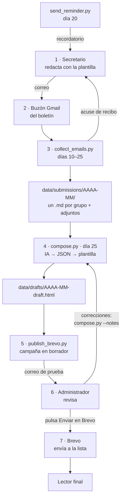

# Boletín parroquial

Sistema que prepara cada mes el boletín parroquial a partir de lo que envían por correo los secretarios de los grupos.

Los secretarios escriben un correo con lo que ha hecho su grupo y lo que viene. Un script recoge esos correos, un modelo de IA redacta el texto con una sola voz y una plantilla fija le da el diseño de la parroquia. El resultado queda como borrador en **Brevo**: el administrador recibe una prueba, la revisa y pulsa *Enviar*. Ningún script manda nada a los feligreses por su cuenta.

> Documentación técnica para agentes de IA: [`AGENTS.md`](AGENTS.md). Guía para los secretarios: [`docs/plantilla-secretarios.pdf`](docs/plantilla-secretarios.pdf).

---

## Del secretario al lector



1. **El secretario redacta.** Usa la [plantilla](docs/plantilla-secretarios.pdf): lo que se ha hecho este mes, las próximas actividades con fecha, hora y lugar, y los avisos. Lo escribe en el **cuerpo** del correo (los adjuntos se guardan, pero no se leen) y lo envía desde la dirección de su grupo que figura en `config.yaml`.
2. **El correo llega al buzón del boletín**, una cuenta de Gmail dedicada.
3. **Recogida** (`collect_emails.py`, cada día del 10 al 25). Busca los correos llegados desde la publicación anterior y los asigna a su grupo por la dirección del remitente. El texto se guarda, junto con el asunto, en `data/submissions/AAAA-MM/<grupo>.md` (el asunto no sirve para identificar al grupo, pero el modelo lo lee por si trae alguna fecha o dato); si un grupo envía varios correos, se añaden uno tras otro y el más reciente manda. Los adjuntos van a `attachments/<grupo>/`. El secretario recibe un acuse de recibo.
   - Los remitentes desconocidos y las respuestas automáticas se ignoran.
   - Lo ya procesado se apunta en `data/submissions/processed.json`, así que da igual que alguien abra el buzón en Gmail y marque los correos como leídos.
   - El día 20, `send_reminder.py` escribe a los grupos que aún no han enviado nada.
4. **Redacción** (`compose.py`, día 25). Junta los envíos del mes y hace **una sola llamada** al modelo de IA (Anthropic u OpenAI), que devuelve el texto en JSON: saludo, una sección por grupo y cierre. El script escapa ese texto, aplica el formato básico (párrafos, negritas, listas, enlaces) y lo mete en `prompts/template.html`. El resultado es `data/drafts/AAAA-MM-draft.html`.
5. **Borrador en Brevo** (`publish_brevo.py`). Crea la campaña del mes como borrador en Brevo, o la actualiza si ya existe, y manda un correo de prueba al administrador.
6. **Revisión.** El administrador lee la prueba tal como la verá el lector. Si hay que cambiar algo:
   ```
   .venv\Scripts\python scripts\compose.py --notes "Quita la fecha del retiro, aún no está confirmada"
   .venv\Scripts\python scripts\publish_brevo.py
   ```
   Se vuelve a redactar con esas indicaciones, se actualiza la misma campaña y llega otra prueba. Los retoques pequeños también se pueden hacer directamente en el editor de Brevo.
7. **Envío.** En Brevo → *Campañas* → el borrador del mes → *Enviar*. Brevo lo manda a la lista de suscriptores y gestiona las bajas: el pie del boletín lleva el enlace *Darse de baja*.

---

## Arquitectura

### Piezas

| Pieza | Qué hace |
|---|---|
| **Gmail** | Buzón de entrada de los envíos (IMAP) y salida de los correos internos: acuses, recordatorios (SMTP). |
| **Scripts Python** (`scripts/`) | Toda la lógica. Sin servidor ni base de datos: el estado son archivos en `data/`. |
| **Modelo de IA** | Solo redacta. No tiene herramientas: no puede navegar, leer archivos ni enviar nada. Su respuesta está limitada a un esquema JSON fijo. |
| **Plantilla HTML** | Único sitio donde vive el diseño (colores, logos, cabecera, pie). El modelo no escribe HTML. |
| **Brevo** | Lista de suscriptores, envío masivo, bajas y estadísticas. El envío final lo decide una persona. |

### Archivos

```
config.yaml              Datos de la parroquia, grupos, IA y Brevo
.env                     Claves (no se sube a git; ver .env.example)
prompts/
  compose.md             Instrucciones para el modelo (qué escribir y en qué formato)
  style.md               Tono y lenguaje
  template.html          Diseño del boletín; el bloque SECTION se repite por grupo
scripts/
  common.py              Utilidades compartidas: .env, config, IMAP/SMTP, estado de envíos
  collect_emails.py      Recoge los correos de los secretarios
  send_reminder.py       Recordatorio a los grupos que faltan
  status.py              Tabla de qué grupos han enviado
  compose.py             Redacta el boletín (IA + plantilla)
  llm.py                 Llamada a la API de Anthropic u OpenAI
  log_tokens.py          Registro de tokens y coste
  publish_brevo.py       Borrador en Brevo + correo de prueba
  run_monthly.py         Proceso del día 25: recoger → estado → redactar → Brevo
  run_daily.py           Lo que lanza el Programador de tareas: decide qué toca hoy
  install.py             Instalación guiada (la lanza instalar.bat)
  install_windows_task.ps1   Crea la tarea programada en Windows
  newsletter-cli.py      Menú interactivo: estado, grupos, ejecutar pasos
data/                    (no se sube a git)
  submissions/AAAA-MM/   Envíos de cada grupo y sus adjuntos
  submissions/processed.json   Correos ya procesados
  drafts/                Borrador HTML y el id de la campaña en Brevo
  token_log.jsonl        Tokens y coste de cada redacción
  run_daily.json         Mes en que se envió el último recordatorio
logs/                    Registro de cada ejecución mensual
docs/                    Guía en PDF para los secretarios y el script que la genera
```

### Seguridad

Los correos que llegan son texto de fuera y podrían traer instrucciones dirigidas al modelo. Por eso:

- el modelo no tiene herramientas y su respuesta tiene que ajustarse a un esquema JSON;
- las instrucciones van en el mensaje de sistema y los correos en el de usuario;
- todo lo que devuelve se escapa antes de entrar en la plantilla, así que no puede colar HTML ni scripts;
- solo se recogen correos de las direcciones registradas en `config.yaml`;
- y nada sale a los lectores sin que el administrador lo revise y lo envíe desde Brevo.

---

## Instalación

Requisitos: Python 3.11 o posterior. En producción funciona en **Windows**; también en Linux o macOS.

### Instalación guiada

En Windows, doble clic en **`instalar.bat`** (en Linux o macOS: `python3 scripts/install.py`). Si no hay Python, lo instala con `winget` y pide volver a abrirlo. Después pregunta, por orden:

1. **Gmail**: la dirección del buzón y su [contraseña de aplicación](https://myaccount.google.com/apppasswords); el correo del administrador.
2. **IA**: Claude u OpenAI, el modelo y la clave de la API.
3. **Brevo**: la clave de la API; con ella lee las listas de contactos y los remitentes verificados para elegirlos de una lista.
4. **Calendario**: días de recogida, recordatorio y borrador; a qué hora se ejecuta, si se repite cada pocas horas y si también al encender el ordenador.

Comprueba cada clave al momento (si Gmail, Brevo o la IA la rechazan, deja volver a escribirla), guarda las claves en `.env` y lo demás en `config.yaml`, crea el entorno `.venv` con las dependencias, crea la [tarea programada](#programarlo-en-windows) y, si se quiere, genera la guía en PDF para los secretarios con la dirección del buzón. Se puede volver a ejecutar para cambiar algo: Intro deja cada valor como está.

Lo único que no pregunta son los grupos y las direcciones de sus secretarios: se ponen en `config.yaml` o con `scripts\newsletter-cli.py` (ver [Grupos y secciones](#grupos-y-secciones)).

### Instalación a mano

En Windows, con Python instalado desde [python.org](https://www.python.org/downloads/windows/), desde la carpeta del proyecto en PowerShell:

```powershell
py -m venv .venv
.venv\Scripts\pip install -r requirements.txt
copy .env.example .env      # y rellenar las claves
```

En Linux o macOS: `python3 -m venv .venv`, `.venv/bin/pip install -r requirements.txt` y `cp .env.example .env`. En los comandos de este documento, cambia `.venv\Scripts\python` por `.venv/bin/python`.

### `.env`

| Variable | Para qué |
|---|---|
| `GMAIL_ADDRESS`, `GMAIL_APP_PASSWORD` | Buzón del boletín. Hace falta una [contraseña de aplicación](https://myaccount.google.com/apppasswords) de Google con la verificación en dos pasos activada. |
| `ADMIN_EMAIL` | Quien recibe la prueba de cada mes. |
| `ANTHROPIC_API_KEY` u `OPENAI_API_KEY` | La del proveedor elegido en `config.yaml`. |
| `BREVO_API_KEY` | Brevo → *SMTP y API* → *Claves API*. |

### `config.yaml`

- `parish`: datos de la parroquia.
- `schedule`: días de recogida, recordatorio y publicación, y la hora y frecuencia de la tarea programada (si se cambian a mano, hay que volver a crear la tarea).
- `groups`: un elemento por sección del boletín (ver abajo).
- `llm`: proveedor y modelo de IA.
  ```yaml
  llm:
    provider: anthropic        # anthropic | openai
    model: claude-opus-5-5     # o claude-sonnet-5-5, más barato; o un modelo de OpenAI
    effort: medium             # solo Anthropic
    # base_url: https://...    # solo openai: cualquier API compatible (Mistral, Ollama…)
  ```
- `brevo`: id de la lista de contactos y remitente.

### Preparar Brevo

1. **Remitente verificado.** En *Remitentes y dominios*, verifica la dirección que pondrás en `brevo.sender_email`. Lo ideal es usar el dominio de la parroquia (`perpetuosocorro.com`) y autenticarlo (SPF/DKIM). Desde una dirección `@gmail.com` el correo llega peor.
2. **Lista de suscriptores.** En *Contactos* → *Listas*, crea la lista del boletín, importa los contactos (que hayan dado su consentimiento) y apunta su id en `brevo.list_id`.
3. **Contacto de prueba.** Añade `ADMIN_EMAIL` como contacto de prueba. Si no, Brevo puede rechazar el envío de la prueba.
4. **Plan.** El plan gratuito permite 300 correos al día y añade la marca de Brevo en el pie.

---

## Uso mensual

| Cuándo | Qué | Comando |
|---|---|---|
| Días 10–25 | Recoger envíos | `.venv\Scripts\python scripts\collect_emails.py` |
| Día 20 | Recordar a los que faltan | `.venv\Scripts\python scripts\send_reminder.py` |
| Cuando sea | Ver quién ha enviado | `.venv\Scripts\python scripts\status.py` |
| Día 25 | Recoger, redactar y subir el borrador a Brevo | `.venv\Scripts\python scripts\run_monthly.py` |
| Tras revisar | Corregir y volver a subir | `compose.py --notes "…"` y `publish_brevo.py` |
| Al aprobar | Enviar | Desde Brevo |

Con la [tarea programada](#programarlo-en-windows) los cuatro primeros pasos van solos; quedan la revisión y el envío.

Opciones útiles:

- `collect_emails.py --dry-run` muestra lo que recogería sin guardar ni enviar nada; `--no-receipt` no manda acuses.
- `compose.py --month 2026-03` y `publish_brevo.py --month 2026-03` trabajan con otro mes. `publish_brevo.py --dry-run` enseña la petición sin llamar a Brevo.
- `scripts/newsletter-cli.py` es un menú con todo lo anterior.

El borrador se puede abrir en el navegador antes de subirlo: `data/drafts/AAAA-MM-draft.html`.

---

## Grupos y secciones

Las secciones del boletín salen de la lista `groups` de `config.yaml`, no de la plantilla. Para añadir una sección, añade el grupo (a mano o con la CLI, *Groups → add*):

```yaml
groups:
  - id: caritas                       # identificador; también nombra su archivo
    name: "Cáritas parroquial"        # título de la sección
    emoji: "❤️"                        # va delante del título
    secretary_email: "caritas@…"      # desde aquí tiene que escribir
    description: "Acción social"
```

Desde ese momento se recogen sus correos, recibe recordatorios y su sección aparece en el boletín con el mismo diseño, en el orden de la lista. Un grupo que no envía nada un mes simplemente no aparece. Para quitar una sección, borra el grupo.

El diseño se cambia solo en `prompts/template.html`. El tono, en `prompts/style.md`.

---

## Programarlo en Windows

El ordenador de la parroquia se apaga cada día, así que no se puede contar con que esté encendido a una hora y un día concretos. Por eso hay una sola tarea, `scripts/run_daily.py`, que se lanza **al iniciar sesión** (cinco minutos después, para que haya red) y **cada día a las 10:00** si el equipo sigue encendido. Cada vez mira la fecha (`schedule` en `config.yaml`) y lo que ya está hecho este mes:

| Día del mes | Qué hace |
|---|---|
| Antes del 10 | Nada. |
| Del 10 al 24 | Recoge los correos. |
| Del 20 al 24 | Además, manda el recordatorio a los grupos que faltan, una sola vez al mes. |
| Del 25 a fin de mes | Proceso mensual (`run_monthly.py`): recoger, redactar, borrador en Brevo y prueba al administrador. Una sola vez: cuando la campaña del mes ya existe en Brevo, no hace nada más. Si falla, lo reintenta la próxima vez que se encienda. |

Así, aunque el ordenador no se encienda el día 20 o el 25, lo hace el primer día que se encienda después. Se puede lanzar varias veces al día sin problema: lo ya recogido no se repite. Lo único que no recupera es un mes en que el ordenador no se encienda ningún día entre el 25 y el final: entonces hay que hacerlo a mano con `compose.py --month AAAA-MM` y `publish_brevo.py --month AAAA-MM`.

La tarea la crea la instalación guiada, con la hora y la frecuencia que se le digan. Para crearla a mano, una vez instalado el entorno (`.venv`), desde la carpeta del proyecto en PowerShell:

```powershell
powershell -ExecutionPolicy Bypass -File scripts\install_windows_task.ps1 -At 10:00 [-EveryHours 4] [-NoLogon]
```

Aparece en el *Programador de tareas* como **Boletin parroquial**; desde ahí se puede ejecutar a mano para probarla. Corre con el usuario que la crea y solo mientras esa sesión está iniciada, sin abrir ninguna ventana. Lo que hace queda en `logs\AAAA-MM.log`. Para quitarla: `Unregister-ScheduledTask -TaskName "Boletin parroquial"`.

En Linux o macOS con un equipo siempre encendido basta una línea de cron:

```cron
0 10 * * *  cd /ruta/parish-newsletter && .venv/bin/python scripts/run_daily.py
```

El envío final no se programa: lo hace el administrador desde Brevo.

---

## Coste

Cada redacción es una llamada a la API. Con nueve grupos cuesta unos céntimos al mes con Claude Opus 5.5, y menos con Sonnet. Los tokens y el coste de cada redacción quedan en `data/token_log.jsonl`. El plan gratuito de Brevo cubre una lista parroquial normal.

## Guía para secretarios

[`docs/plantilla-secretarios.pdf`](docs/plantilla-secretarios.pdf) explica cómo y cuándo enviar, e incluye una plantilla para copiar en el correo y un ejemplo rellenado. Se genera con `docs/make_plantilla.py`; para poner en el PDF la dirección del buzón:

```bash
python3 docs/make_plantilla.py --to boletin@example.com     # en Windows: py docs\make_plantilla.py
```
